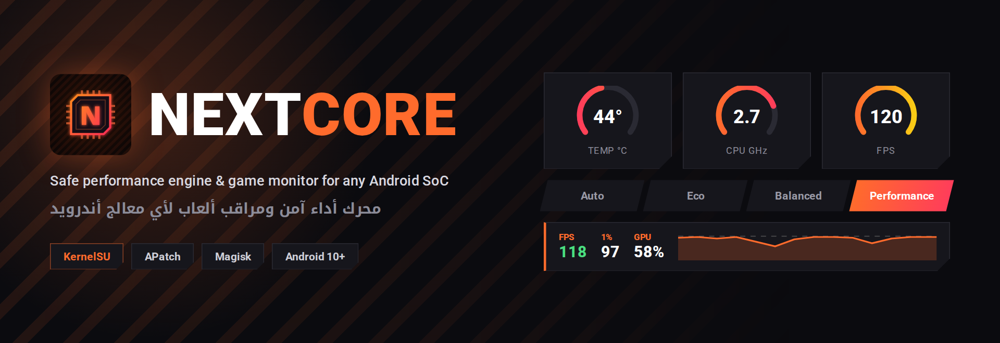

<p align="center">
  
</p>

<p align="center">
  <a href="https://github.com/ifoknr/NEXTCORE/releases/latest"></a>
  
  
  <a href="https://t.me/IFOKNR1"></a>
  
</p>

<p align="center">
  <b>English</b> · <a href="READMEs/README_ar-SA.md">العربية</a>
</p>

**NextCore** is a performance module for KernelSU, APatch and Magisk with a companion app for control and game monitoring. It reads your SoC on every boot, applies what fits it safely, and switches profiles when a game opens.

#### ⚡ Performance

| | |
| :--- | :--- |
| **Sustained mode** | Raises the CPU floor (70% of max on big clusters, 50% on the smallest) and lets the governor scale above it. The chip heats slower and stays fast longer. |
| **Game priority** | uclamp moves the game to the fast cores and caps background work; vendor values come back in Balanced. |
| **GPU & memory** | Performance raises the floor to the middle step and leaves the ceiling open. Full clocks only in **Max performance**. |
| **Eco** | Caps GPU and memory at the middle step instead of pinning the lowest. |
| **Per game** | Downscale, FPS target, renderer, refresh rate, do not disturb, bypass charging. |

#### 🛡️ Safe on any device

- No read-only locks on kernel nodes, so vendor thermal can always lower clocks.
- Thermal governors and services are left alone, and a kernel panic still reboots.
- The background cleaner only stops your own apps; keyboard, messaging, calls, music and alarms keep running.
- Any tweak whose node is missing in your kernel is skipped.

#### 📱 App

| | |
| :--- | :--- |
| **Home** | Service status, live gauges, modes, the running game, a 30-minute chart, today's stats. |
| **Engines** | CPU, memory and frames pages (live FPS, average, 1% low, stability). |
| **Sessions** | Every play session with duration, average FPS and peak temperature, plus per-game totals. |
| **Floating monitor** | 20 readings to pick and reorder, three layouts, an FPS graph, updates down to 250 ms. |

#### 🎮 Floating monitor

FPS is read in real time from the game's own frame times in SurfaceFlinger, with frame time, 1% low and stutters.
Also: CPU clock, clusters, load and temperature; GPU load, clock and temperature; RAM; battery temperature, level and power draw; thermal status; network; ping; clock; session time.
Long-press the panel in game to switch layout; drag it to move it.

#### 🧩 SoCs

| SoC | Support |
| :--- | :--- |
| MediaTek · Snapdragon · Exynos · Tensor · Unisoc | **Full:** general and chipset tweaks |
| Others | **Partial:** general tweaks whose nodes exist in your kernel |

#### 📦 Install

1. Remove AZenith if installed and reboot.
2. Download the latest [release](https://github.com/ifoknr/NEXTCORE/releases/latest) and flash it in your root manager.
3. Reboot, open the NextCore app and grant root.

If something goes wrong at boot, create `/data/local/tmp/nextcore_abort` and the service will not start.

<details>
<summary><b>Terminal commands</b></summary>

```sh
sh /data/adb/modules/nextcore/action.sh get_status     # status
sh /data/adb/modules/nextcore/action.sh set_profile 1  # 1 performance · 2 balanced · 3 eco
sh /data/adb/modules/nextcore/action.sh set_auto 1     # auto mode
sh /data/adb/modules/nextcore/action.sh doctor         # diagnostics
```

</details>

<br>

<sub>Bug reports: open an <a href="https://github.com/ifoknr/NEXTCORE/issues">issue</a> with the output of <code>action.sh doctor</code> · Apache License 2.0, see <a href="LICENSE">LICENSE</a> and <a href="NOTICE.md">NOTICE.md</a></sub>

<sub>Based on <a href="https://github.com/Liliya2727/AZenith">AZenith</a> by Zexshia, under the Apache License 2.0.</sub>
